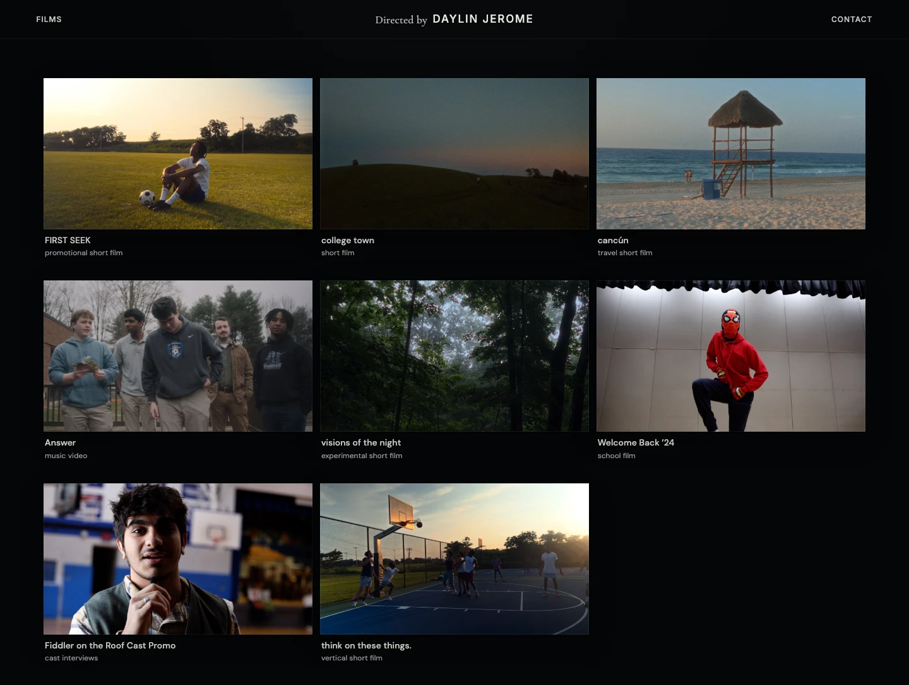
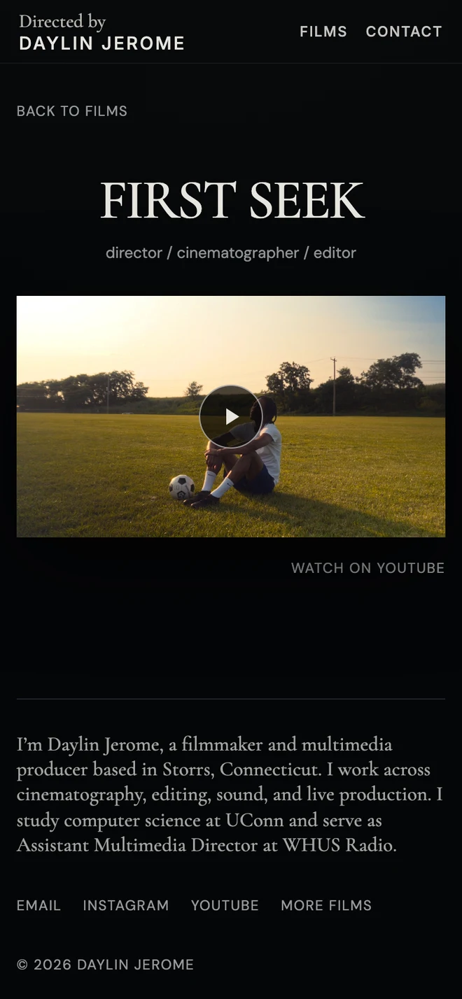

# Daylin Jerome — Film Portfolio

Eight selected films by filmmaker and multimedia producer Daylin Jerome, spanning short films, a music video, and collaborative school productions.

[**View the live film portfolio**](https://daylinjerome.pages.dev/)



The responsive grid presents each film with a still and a short format label. Each title opens its own screening page with Daylin’s role, a click-to-load YouTube player, and a direct watch link. The film catalog lives in [`src/data/films.ts`](src/data/films.ts), which holds the order, titles, full credits, captions, and media references.



## Implementation

The project started as a Figma Make export. The React and Vite implementation was refined for responsive layouts, shareable film URLs, a keyboard-accessible Contact panel, and local thumbnail and font assets. The production build was checked in the Cloudflare Pages emulator at desktop and phone widths, including direct navigation and refresh on the FIRST SEEK route.

Project credits and original video destinations are listed in the film catalog. The locally hosted Inter, DM Sans, and Cormorant Garamond fonts include their [SIL Open Font License notices](public/fonts/).

## Local setup

Use Node.js 22.12 or newer and pnpm 10.34.3.

```sh
pnpm install --frozen-lockfile
pnpm dev
```

To review the production build, run `pnpm build` followed by `pnpm preview`, then open the HTTP URL Vite prints.

## Cloudflare Pages

In **Workers & Pages**, create a **Pages** project using **Connect to Git**. Select this repository and use the settings below.

| Setting | Value |
| --- | --- |
| Framework preset | React (Vite) |
| Production branch | `main` |
| Root directory | Leave blank to use the repository root |
| Build command | `pnpm build` |
| Build output directory | `dist` |
| Build environment variables | `NODE_VERSION=22.23.5`, `PNPM_VERSION=10.34.3` |

Pages serves the React app for deep links through its default single-page app fallback. [Cloudflare Pages Git integration](https://developers.cloudflare.com/pages/get-started/git-integration/) · [Build settings](https://developers.cloudflare.com/pages/configuration/build-configuration/)
